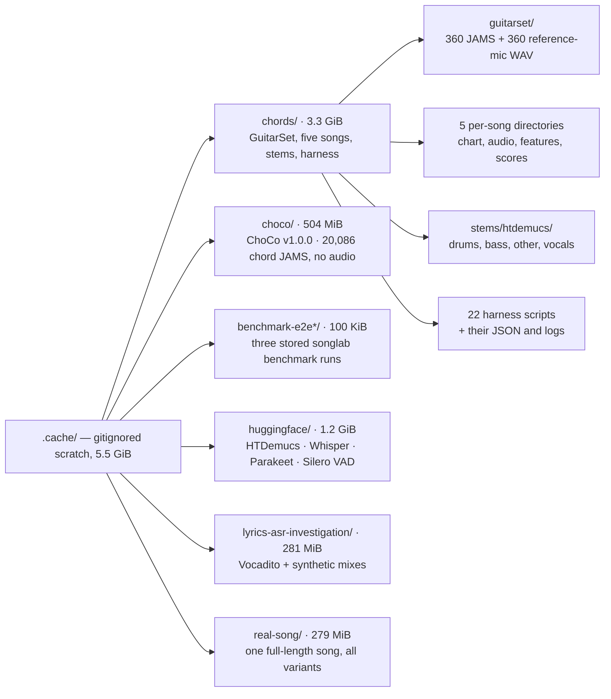

# song-chord-lyrics-analyzer

[](https://github.com/wachin/song-chord-lyrics-analyzer/actions/workflows/ci.yml)
[](LICENSE)
[](pyproject.toml)
[](#installation)
[](#design-principles)
[](#design-principles)
[](https://github.com/astral-sh/ruff)
[](#development)

A cross-platform, offline-first laboratory that analyzes an audio song and
produces a synchronized representation of its **lyrics, chords, beats, tempo
and key** — with confidence and provenance attached to every inference.

> ━━━━━━━━━━━━━━━━━━━━━━━━━━━━━━━━━━━━━━━━━━━━━━━━━━━━━━━━━━━━━━━━━━━━━
>
> **✦ BUILD WITH YOUR AI AGENT ✦**
>
> Read **[docs/AGENT_ONBOARDING.md](docs/AGENT_ONBOARDING.md)** for the setup
> guide, repository map, verification gate and a ready-to-paste prompt for your
> agent. Pick a roadmap item, bring your agent, and help build the program.
>
> ━━━━━━━━━━━━━━━━━━━━━━━━━━━━━━━━━━━━━━━━━━━━━━━━━━━━━━━━━━━━━━━━━━━━━

* **Package:** `song_chord_lyrics_analyzer`
* **CLI:** `songlab`
* **Platforms:** Linux, Windows, macOS
* **Licence:** GPL-3.0-or-later
* **Status:** the *first product milestone* is reached **in two front ends**. The
  whole path runs end to end: real audio file → shared decode service → chord
  analysis → timestamped `ChordEvent`s → playback → the chord under the playhead,
  drawn by `songlab play` as a terminal line (see the
  [demo](docs/USAGE.md#demo-the-chords-follow-the-song)) and by `songlab gui`
  in a **desktop window** with a waveform timeline, a chord strip, a seekable
  playhead and a **chord chart over the synchronized lyrics** (roadmap Phases D
  and F). The
  repository, CLI, canonical typed model, engine interfaces, audio metadata,
  playback layer, tests and CI are all in place, and four engines are registered:
  chords `chroma-baseline` (CQT chroma matched against harmonic-weighted triad
  templates through an optional numpy/librosa front end), lyrics
  `parakeet-onnx`, key `krumhansl` and tempo `librosa-tempo`. The window also
  carries editing/undo-redo, transpose/simplify, the export dialog, external
  `.lrc`/`.srt` lyrics and a plain-text chart import. What is still open is translations and the deeper
  accuracy work. The one recorded chord-accuracy figure is duration-weighted
  **CSR 0.6312** on 180 GuitarSet comping takes against the instructed lead
  sheet (2026-10-27, `scripts/chord_benchmark.py`; up from 0.6121 after the
  measured front-end/template change, all recorded in
  [`docs/ENGINE_COMPARISON.md`](docs/ENGINE_COMPARISON.md)). It is a measured
  score on solo acoustic guitar, **not** a claim that every song is 93 % correct:
  the apps that advertise such numbers use different, non-public evaluations and
  a much larger learned model.


## Why

Most tools hide a single model behind a single button. This project keeps the
analysis engine modular and inspectable, so a result is reported as:

```text
Chord: C
Confidence: 0.84
Time: 01:24.320–01:26.810

Evidence:
- Chordino: C
- Madmom: C
- Baseline: C/E
- Bass evidence: E
```

instead of pretending the algorithm is certain. Raw engine output is never
overwritten, and disagreement between engines is preserved rather than averaged
away.

## The problem we set out to solve: audio that already knows its chords

To know whether chord recognition is *right*, you need a reference: **song audio
paired with the name of the chord sounding at each moment** — audio segments
labelled with chords. Half of this project's research went into finding such a
resource, and the honest answer is that very few exist.

The search covered dozens of repositories, datasets and audio libraries. The
finding: **the resource we wanted already exists, and it is [GuitarSet](https://zenodo.org/records/3371780).**

| Source | Real song audio | Chord labels with timestamps | Licence | Verdict |
| --- | --- | --- | --- | --- |
| **GuitarSet** | yes — 360 real acoustic-guitar excerpts | yes — JAMS with chord (instructed *and* performed), beats, downbeats, tempo and key | **CC BY 4.0** | **adopted** — the one source with audio *and* timed chord boundaries under a permissive licence |
| Guitar-TECHS | yes — electric guitar, notes/scales/chords | chord/technique examples with per-string MIDI | CC BY 4.0 | candidate — note-level, not song progressions |
| isolated-guitar-chords | isolated single chords only | yes, one chord per clip | CC BY 4.0 | complementary — clean unit audio, not songs |
| EGFxSet | single notes through guitar effects | note-level | CC BY 4.0 | candidate — note-level |
| guitar-chord-mix | repack of the above | per-string note MIDI, not chord sequences | CC BY 4.0 / CC0 | redundant — its rows are already covered by GuitarSet |
| ChoCo | **no audio** | yes — 20,080 JAMS files | CC BY 4.0 (some partitions NC-SA) | annotations only — pair with audio you own |
| CASD | **no audio** | yes — 4 annotators per song | CC BY-NC-SA 4.0 | blocked — NC/SA, incompatible with GPL-3 |
| IDMT-SMT-Guitar / Chords / Chord-Sequences | synthetic or non-permissive | yes | CC BY-NC-ND 4.0 | blocked — NC/ND |
| chord-collection, frettler | **no audio** (fingering databases) | no | GPL / OLGA-derived | fingering reference only |

Two structural facts came out of this search, and both shaped the design:

1. **Audio rarely travels with the annotations.** Most timed chord references
   (ChoCo, CASD, Isophonics) ship labels only, because the recordings stay under
   their original copyright. GuitarSet is the exception.
2. **Permissive licences are the bottleneck.** The richest chord datasets
   (IDMT, CASD) are non-commercial or no-derivatives, so nothing from them may
   be committed into a GPL-3 repository.

GuitarSet's annotations were therefore pinned into **derived, annotation-only
fixtures** that tests and metrics run against, with the dataset licence and
provenance recorded inside the fixture itself:

* [`tests/fixtures/csr_oracle.json`](tests/fixtures/csr_oracle.json) — timed chord
  annotations for 22 comping takes plus the expected duration-weighted CSR.
* [`tests/fixtures/chord_metrics_oracle.json`](tests/fixtures/chord_metrics_oracle.json)
  — 143 pinned cases (alignment, evaluation and boundary metrics) cross-checked
  against NumPy and `mir_eval` reference implementations.

No audio is committed; only annotations and measured numbers. The full policy is
in [`docs/DATASET.md`](docs/DATASET.md).

### What else is in `.cache/` (the local scratch space)

`.cache/chords/guitarset/` is only the largest tenant of a **gitignored scratch
directory at the repository root**. Everything the research and measurement work
downloads or generates lives under `.cache/`, and none of it belongs to the
package:

* **It is not the runtime cache.** That one is `SONGLAB_CACHE_DIR` or the
  platform default that `songlab doctor` prints — `~/.cache/songlab` on Linux,
  `~/Library/Caches/songlab` on macOS, `%LOCALAPPDATA%\songlab\Cache` on Windows.
  No module in `src/` opens `.cache/`.
* **It is not in the history.** `.gitignore` line 58 ignores the whole directory,
  so a fresh clone simply starts without it.
* **It is not needed to run or test.** The tests read the committed annotation
  fixtures in [`tests/fixtures/`](tests/fixtures/), never the audio.

Measured in this checkout on 2026-10-18: **5.5 GiB**. The directory maps the
research that produced the numbers quoted in the docs:



Each tenant answers one question: `chords/` the chord accuracy, `choco/` the
annotation index and `--ref` loader checks, the `huggingface/` weights plus
`lyrics-asr-investigation/` and `real-song/` the lyrics comparison, and
`benchmark-e2e*/` the `songlab benchmark` command itself. The outcomes are what
[`docs/CHORD_DETECTION_AUDIT.md`](docs/CHORD_DETECTION_AUDIT.md),
[`docs/ENGINE_COMPARISON.md`](docs/ENGINE_COMPARISON.md) and
[`docs/DATASET.md`](docs/DATASET.md) record.

The same layout as a table: sizes are the `du` figures on 2026-10-18 in binary
units, so a file of a few kilobytes shows as the 4 KiB block it occupies.

| Path | Size | What it holds |
| --- | --- | --- |
| `chords/guitarset/` | 2.1 GiB | The measurement dataset: 360 takes (`.jams` + `_mic.wav`), 24 lead sheets and the two Zenodo zips. Detailed in the next subsection. |
| `chords/guitarset-features/` | 4.6 MiB | One `original.npz` per take, the cached feature matrix, so re-scoring does not decode the audio again. |
| `chords/guitarset-<take>/` | 61 MiB (24 dirs) | The 24-take sample run: a copy of one take's audio, its `features/original.npz`, `results/original.json` with the detected key and decoded chord segments, and `csr.json` with that take's per-view CSR rows. |
| `chords/<song>/` | 127 MiB (5 dirs) | One directory per user-supplied song — `abre-mis-ojos`, `a-quien-ire`, `gracia-sublime`, `levanto-mis-manos`, `palabras-de-vida-eterna`: `chart.json` (hand-written chord chart), `original.wav`, `features/*.npz`, `results/*.json` per stem condition, and the score files `csr.json` (agreement mode), `metrics.json`, `variants.json`, `transitions.json`, `robust.json` and `summary.json`. `gracia-sublime` also keeps its `lrclib.json` lyrics lookup. |
| `chords/stems/htdemucs/` | 985 MiB | Demucs four-stem separations (`drums`, `bass`, `other`, `vocals`) of those five songs — the material behind the "does separation help chords?" comparison. |
| `chords/*.py`, `*.json`, `*.log` | ~5 MiB | The historical throwaway harness: `chords.py` (the original decoder), `measure_decoders.py`, `measure_key.py`, `measure_tempo.py`, `guitarset_*.py`, `fit_*.py`, `sweep_v3.py`, `winner_sweep.py`, and `gen_key_oracle.py`, `gen_metrics_oracle.py`, `make_fixture.py` and `validate_oracle.py`, which generated the committed fixtures. Their JSON, JSONL and log outputs sit next to them. Since 2026-10-19 the reproducible chord harness is committed at `scripts/chord_benchmark.py`; these files are what it replaced. |
| `choco/` | 504 MiB | ChoCo v1.0.0 as downloaded (178 MiB zip) and extracted: `jams/` with 20,086 chord annotations, `meta.csv` and `LICENSE.md`. Annotation-only — no audio. It is the permissively licensed timed source the search settled on: its `meta.csv` showed it shares no song with the five charts, and its Harte-seconds JAMS are what `evaluation.guitarset.read_jams_chords` was validated on. |
| `benchmark-e2e/`, `benchmark-e2e-key/`, `benchmark-e2e-tempo/` | 100 KiB | Three stored `songlab benchmark` runs (chords on 2026-10-04, key and tempo on 2026-10-05): `cases/case.json` plus a symlink to the GuitarSet take being scored, and `reports/benchmark.{json,csv,md}`. `benchmark-e2e/make_case.py` regenerates the chord case from the JAMS. |
| `huggingface/` | 1.2 GiB | A Hugging Face download cache (`hub/` plus `xet/` logs) holding the four repositories the experiments pulled: HTDemucs (81 MiB of weights), faster-whisper-small (462 MiB), Parakeet TDT 0.6B ONNX (622 MiB encoder) and Silero VAD (2.3 MiB). No registered engine loads these, so the application never touches them. |
| `lyrics-asr-investigation/` | 281 MiB | The Whisper-versus-Parakeet comparison: `probe.py`, three driver scripts, `data/` (Vocadito excerpts and zip, six synthetic mix/stem conditions, Demucs output), `results/` (one JSONL plus metadata per engine and condition, and `summary.json`) and the run logs. |
| `real-song/` | 279 MiB | One full-length commercial song (272.04 s) taken end to end: `original.wav` and a 16 kHz copy, `stems/htdemucs/`, `results/` per engine, `diagnostics/`, the lyric reference and `summary.json`. |
| `lyrics/gen_lyrics_oracle.py` | 8 KiB | Generator for `tests/fixtures/lyrics_oracle.json`: deterministic perturbations of the committed references, scored by `jiwer`. |
| `chordify-initial-data.json` | 20 KiB | A saved Chordify page payload (Next.js `__NEXT_DATA__`) for one song, research evidence for "what does Chordify actually output?". Nothing reads it. |
| `cache.txt` | 1.2 MiB | A `tree` dump of this directory, 22,376 lines. A snapshot, not an input: delete and regenerate it when it goes stale. |
| `chords_venv_build.log` | 0 B | Empty leftover of the throwaway harness virtualenv build. |

To see the layout yourself:

```bash
du -sh .cache/* | sort -h     # what is large
find .cache -maxdepth 1 -mindepth 1 -type d -exec du -sh {} +
tree -a -L 2 .cache           # needs the `tree` package
```

All of it is reproducible from its source (the two Zenodo zips, the ChoCo
`v1.0.0` release, the Hugging Face repositories, or the harness scripts) except
the audio of the five songs and of `real-song/`: that is commercial material
supplied by the user, gitignored, never committed and never redistributed, and
this project cannot download it again. Deleting `.cache/` therefore loses those
local checks and the cached features, not anything the package needs. The next
subsection covers the GuitarSet part in detail.

### The GuitarSet copy on disk (`.cache/chords/guitarset/`)

When GuitarSet is used locally, it lives in the **gitignored cache at the
repository root**, not in the package and not in this repository's history:

```text
.cache/chords/guitarset/
```

The application never opens this path. It is the input of the *measurement* work
behind the recorded chord numbers — **CSR 0.6312** on 180 comping takes against
the instructed lead sheet (2026-10-27, up from 0.6121), and the confidence
calibration fitted on the same corpus, recorded with their environment and date
in [`docs/ENGINE_COMPARISON.md`](docs/ENGINE_COMPARISON.md) §6, §7 and §8 — and
the harness that scores it is committed at `scripts/chord_benchmark.py`, driven
by the committed manifest
[`tests/fixtures/guitarset_comp_manifest.json`](tests/fixtures/guitarset_comp_manifest.json).
Only that manifest is in the repository; the audio never is.

#### Why your file manager cannot find it

Two ordinary reasons, neither of them a missing download:

* **The path starts with a dot.** `.cache` is a *hidden* directory, and file
  managers hide names beginning with `.` by default. In Thunar (the MX Linux
  default) press `Ctrl+H` or choose **View → Show Hidden Files**; Dolphin and
  Nautilus use the same shortcut. Nothing is missing — it is filtered out of the
  listing.
* **It sits in the repository, not in your home directory.** The path is relative
  to the clone, so it is *not* `~/.cache/...`. With a clone at
  `/home/user/Dev3/song-chord-lyrics-analyzer` (machine-specific example) the
  absolute path is
  `/home/user/Dev3/song-chord-lyrics-analyzer/.cache/chords/guitarset/`.
  Use `Ctrl+L` and paste the path, or from a terminal:

```bash
cd /path/to/song-chord-lyrics-analyzer/.cache/chords/guitarset
ls -lh | head          # the extracted files
```

#### What is inside

The directory is **flat — no subdirectories**. Counts and sizes below were
measured on 2026-10-18 in this checkout: **746 files, 2.1 GiB** (sizes in MiB, as
`du` reports them).

```text
.cache/chords/guitarset/
├── annotation.zip              37 MiB   original Zenodo annotation download (39.1 MB published)
├── audio_mono-mic.zip         627 MiB   original Zenodo audio download (656.9 MB published)
├── <take>.jams                360 files, 543 MiB   annotations, one per take
├── <take>_mic.wav             360 files, 923 MiB   audio, one per take
└── <take>.chart.txt            24 files, <100 KB  plain-text instructed lead sheets
```

| Entry | What it is |
| --- | --- |
| `annotation.zip` | The untouched `annotation.zip` from [Zenodo 10.5281/zenodo.3371780](https://zenodo.org/records/3371780): 39.1 MB / 37.3 MiB, the size the record publishes. MD5-verified against the record on 2026-09-29. Kept only as the original; the extracted `.jams` are what gets read. |
| `audio_mono-mic.zip` | The untouched `audio_mono-mic.zip` from the same record: 656.9 MB / 626.5 MiB, also as published. Same provenance and MD5 check. The extracted `.wav` files are what gets read, so the two zips (664 MiB together) are redundant once extraction has happened. |
| `<take>.jams` | JAMS annotation per take — JSON text, 0.24–6.1 MB (1.5 MB average). Each holds **17 annotations** (recounted 2026-10-18): two `chord` namespaces (index 0 = instructed lead sheet, index 1 = performed, semi-automatic transcription with manual verification), `key_mode`, `tempo`, `beat_position`, and six `pitch_contour` plus six `note_midi` (one per string). Excerpts run **14.40 s to 45.71 s** (median 29.69 s). |
| `<take>_mic.wav` | The reference-microphone mono mix the decoder analyses: **44.1 kHz, 16-bit PCM, one channel**, 1.2–3.8 MB each. GuitarSet also ships hexaphonic and pickup audio; those zips were not downloaded. |
| `<take>.chart.txt` | The instructed chord sheet in plain text for a 24-take subset (all `comp` takes), e.g. `[instructed lead sheet]` followed by one chord per line. Small enough to read in an editor. |

#### The take names

Every extracted file is named `<player>_<style><progression>-<bpm>-<key>_<comp|solo>`,
so `00_BN1-129-Eb_comp_mic.wav` is player `00`, style `BN` (bossa nova),
progression 1, 129 BPM, E♭ major, comping, reference-mic audio:

| Part | Meaning |
| --- | --- |
| `<player>` | `00`–`05`, the six GuitarSet players, 60 files each. |
| `<style>` | `BN` (bossa nova), `Funk`, `Jazz`, `Rock`, `SS` (singer-songwriter); 72 takes each. |
| `<progression>` | `1`–`3`, each appearing with two tempo/key variants, so every style has six pieces per player. |
| `<bpm>` | Tempo of that recording. |
| `<key>` | Sounding key, e.g. `Eb`, `C#`, `Bb`, `F#` — 13 key spellings in the set. |
| `comp` / `solo` | Comping (chordal accompaniment) or lead playing; **180 each**, both annotated. |

#### The rest of `.cache/chords/`

Next to `guitarset/` sit the scratch artefacts from the 2026-09-29 measurement
run. All of it is gitignored scratch state, and none of it is needed to run the
package:

* `guitarset_all.py`, `guitarset_aggregate.py`, `guitarset_ablation.py` — the
  decoding/aggregation scripts, with `guitarset_all*.jsonl`, `guitarset_*summary.json`
  and `guitarset_csr_views.log` holding their output.
* 24 `guitarset-<take>/` working directories from the sample run, each with
  `original.wav`, `features/`, `results/` and a `csr.json` holding that take's
  per-reference CSR rows.
* `guitarset-features/` — per-take feature dumps. The working directories and
  the feature dumps together take 66 MB.

The other tenants of `.cache/` — the five song directories, their stems, ChoCo,
the model downloads and the stored benchmark runs — are listed in the overview
above.

GuitarSet is **CC BY 4.0**: the audio may be kept and measured locally, but it is
never committed or redistributed here. Deleting `.cache/chords/guitarset/` only
means re-extracting the two Zenodo zips into the same path; the committed
annotation fixtures and the tests keep working without it.

## Design principles

1. **No GUI first.** The command-line laboratory was built and validated before
   any PyQt6 code existed; the window (Phase D) then arrived as one more client
   of the same session, so it holds no analysis of its own.
2. **Engines behind interfaces.** Any chord or lyrics engine is an adapter; the
   CLI and GUI never import it directly.
3. **A canonical typed model.** Not Markdown, not ChordPro — those are exporters.
4. **Uncertainty survives.** `unknown` is not `0.0`, unknown is not "no chord",
   and tempo ambiguity is reported rather than normalised.
5. **No unnecessary dependencies.** The core package has none.
6. **Cross-platform from day one.** `pathlib`, platform-aware path discovery, and
   no hard-coded `/tmp` or `C:\Users\...`.
7. **English first.** Translations come only after the English UI is frozen.
8. **Never invent numbers.** A benchmark, timing or accuracy figure is written
   down only if it was measured, and it states its environment and date.

## Where the project is going

The roadmap is a phase plan, and the analysis engine is built behind interfaces
before the CLI is allowed to grow. Current state and direction:

| Area | State |
| --- | --- |
| Repository, CLI, canonical typed model, engine protocols, audio metadata | **implemented** |
| Dependency and licence research (candidates adopted/deferred/rejected) | **done** |
| Chord metrics — timing-free (align, exact/root/quality/MIREX views) and boundary-aware (segment overlap, change detection, timing error) | **library code, dependency-free** |
| Lyrics / key / tempo engines behind the interfaces | **implemented** (lyrics `parakeet-onnx`, key `krumhansl`, tempo `librosa-tempo`); a beat engine is still not started |
| `songlab benchmark` — `benchmark/{benchmark.json,csv,md}` over stored results | implemented; `--engine` runs a registered chord engine over cases with audio |
| `songlab chords` — first analysis command, on a selectable registered engine | implemented |
| `songlab analyze` — chord + key + tempo (+ lyrics) engines assembled into the canonical document with provenance | implemented |
| `songlab play` — playback plus the chord under the playhead, refreshed as the song advances (`--at` for one position) | implemented |
| `chroma-baseline` engine — harmonic-weighted templates with a measured Viterbi decoder, per-event confidence, key-aware display spelling | implemented (accuracy measured at CSR 0.6312 on 180 GuitarSet takes, 2026-10-27) |
| `krumhansl` key engine — chroma profile vs the Krumhansl-Kessler profiles (roadmap 31/32) | implemented |
| `librosa-tempo` tempo engine — BPM with half/double readings kept (roadmap 33) | implemented |
| Stem separation, alignment, fusion | lyrics alignment (`.lrc`/`.srt`) implemented; stems and fusion later |
| PyQt6 window — waveform timeline, chord strip, seekable playhead, chord label, analysis panel (`songlab gui`) | **implemented** (Phase D, minimal window; optional `gui` extra) |
| Editing, undo/redo, **chord-over-lyrics chart**, lyrics view, transpose, exports in that window | **implemented** (2026-10-09..21); translations remain (`[F]`, see [`docs/GUI_REQUIREMENTS.md`](docs/GUI_REQUIREMENTS.md)) |

The metric definitions are already fixed in [`docs/BENCHMARK.md`](docs/BENCHMARK.md):
chord (exact/root/quality + segment overlap + timing error + change detection),
lyrics (WER/CER + word-timestamp error), key (exact + relative), tempo (absolute
and half/double BPM error, ambiguity reported not normalised). The order of work
lives in [`ROADMAP.md`](ROADMAP.md).

## Installation

Requires Python 3.10+ and `venv` + `pip`.

```bash
git clone https://github.com/wachin/song-chord-lyrics-analyzer
cd song-chord-lyrics-analyzer

python -m venv .venv
source .venv/bin/activate          # Windows: .venv\Scripts\Activate.ps1

python -m pip install --upgrade pip setuptools wheel
python -m pip install -e .         # add ".[dev]" for tests, linting, mypy

# to open the window, and to hear the song it plays:
python -m pip install -e ".[gui,dsp,playback]"
```

FFmpeg is optional but recommended: WAV files work out of the box, everything
else needs `ffmpeg` + `ffprobe` on your `PATH` (or in `SONGLAB_FFMPEG` /
`SONGLAB_FFPROBE`). See [`docs/TROUBLESHOOTING.md`](docs/TROUBLESHOOTING.md).

## Quick start

This is the shortest path to the window:

```bash
cd /path/to/song-chord-lyrics-analyzer
source .venv/bin/activate          # or .venv-chords, if that is your environment
songlab gui
```


Use **Open...** in the window, or pass a file directly with
`songlab gui song.mp3`. The window needs the `gui`, `dsp` and `playback` extras;
the installation section above installs them.

The detailed command-line guide, the `songlab play` demo, the window details,
the MX Linux launch example and the screenshots are in
[`docs/USAGE.md`](docs/USAGE.md). Developers should start with
[`docs/DEVELOPMENT.md`](docs/DEVELOPMENT.md).

## What works today

| Capability | State |
| --- | --- |
| Canonical typed model (audio, lyrics, chords, beats, key, tempo, notes, stems, provenance) | implemented |
| Chord label parsing, rendering, transposition, uncertainty handling | implemented |
| Canonical JSON codec with schema version | implemented |
| Engine protocols + registry (`is_available`, `engine_info`) | implemented |
| Audio validation, FFmpeg discovery, metadata probing (WAV without FFmpeg) | implemented |
| `songlab info`, `songlab doctor`, error handling and exit codes | implemented |
| `songlab chords` — chord detection on a registry-selected engine (`--engine`, `--json`, time range) | implemented |
| Chord decoder — bulk majority smoothing or max-sum Viterbi with a measured change penalty, no-chord state and a 0.50 s minimum-duration merge | implemented (defaults re-measured 2026-10-27) |
| Per-chord confidence — the emitted label's score margin mapped through a logistic calibrated on GuitarSet (held-out Brier 0.1485, ECE 0.0363, accuracy 0.809 at coverage 0.476); shown in `songlab analyze`, the window's panel and the chord tooltip | implemented (2026-10-21 refit) |
| Key-aware display spelling — flat keys show `Bb`/`Eb`/`Ab` while the canonical document keeps sharps (held-out key from `krumhansl`) | implemented (2026-10-21) |
| `krumhansl` key engine — key, mode and correlation confidence, scored by `songlab benchmark --engine` | implemented |
| `librosa-tempo` tempo engine — BPM scored as absolute, half-time and double-time error by `songlab benchmark --engine` | implemented |
| `songlab analyze` — the canonical document (`AnalysisResult` + `Provenance` + `AnalysisRun`) from the registered engines | implemented |
| `songlab play` — play a file and show the chord under the playhead, updating with playback (terminal display; `--at`, `--interval`, `--frames`) | implemented |
| `songlab gui` — the desktop window: waveform timeline, chord bands, playhead, transport, seek, analysis panel (optional `gui` extra) | implemented (minimal window, roadmap Phase D) |
| Chord-over-lyrics chart — chord onset anchored to the timed word, instrumental gap rows, current chord highlighted, same clock as the playback | implemented (2026-10-21, `app/chord_lyrics.py` + `gui/lyrics_view.py`) |
| `SongSession` + presenters (`app/`) — open → decode → analyze → player → `chord_at()` → `SessionSnapshot` → frame, band and summary rows | implemented |
| Waveform peak data (`audio/peaks.py`) — min/max per drawn column, frame-aligned, dependency-free | implemented |
| Chord metrics (`metrics/`) — timing-free and boundary-aware scoring views | implemented as library code |
| Key, tempo and lyrics metrics (`metrics/`) — WER/CER, key relation, half/double BPM | implemented as library code |
| Chord scoring semantics (`evaluation/`) — MIREX equality, duration-weighted CSR | implemented as library code |
| `songlab benchmark` — scores stored reference/hypothesis cases into `benchmark/{json,csv,md}` | implemented; `--engine chroma-baseline` fills cases from a real measured run |
| Local hand-chart sequence check — `scripts/chord_chart_check.py` parses a plain-text chart and aligns its chords to the detector, no timestamps required | implemented (2026-10-27) |
| **Import a plain-text chart** — Edit → Load chord chart... (`Ctrl+Shift+L`): chart chords anchored under the chart's own chord columns, lyric lines timed from the transcript, instrumental runs distributed between anchors, saved through the sidecar | implemented (2026-10-27; column/word timing, not beat-level) |
| GUI editing, undo/redo, lyrics view, **chord-over-lyrics chart**, transpose, simplify and the export dialog | implemented (2026-10-09..21) |
| GUI translations — the Language menu ships, no catalogue does | not started (`[F]` work) |
| Further chord decoders (a learned engine is the measured next step), beat engine, stem separation, fusion | not started |

## Checking a song against your own chord chart

If a song already has a hand-written chart, that chart is a useful local
reference without needing timestamps. `scripts/chord_chart_check.py` parses the
common plain-text format — a line whose tokens are all chords is a chord line,
`[Section]` headers are labels, every other line is lyrics — and aligns the
chart's chords to the detector's sequence:

```bash
# run the engine on the song and compare
python scripts/chord_chart_check.py \
    --chart "my song.txt" \
    --audio "my song.mp3"

# or reuse a saved result
songlab chords "my song.mp3" --json > /tmp/chords.json
python scripts/chord_chart_check.py \
    --chart "my song.txt" --chords-json /tmp/chords.json
```

On a private 5:27 Spanish worship recording with an 86-chord hand chart, the
current engine matched **84 of 86 chart chords in order (97.7%)**, with two
substitutions and fifteen extra detections (2026-10-27). That is
**sequence agreement**, not duration-weighted accuracy: the chart has no
timestamps, an abridged chart or a repeated section written only once will show
missing/extra chords that are not detector mistakes, and the song/chart stay
private and are not committed. The tool is developer tooling, not a `songlab`
command; its parser and alignment are in `evaluation/chart.py`, its semantics
are documented in [`docs/BENCHMARK.md`](docs/BENCHMARK.md), and the timed
GuitarSet number remains the one quoted as accuracy.

### Importing it into the window

The window can use that chart as the actual lyric and chord source instead of
just checking against it: **Edit → Load chord chart...** (`Ctrl+Shift+L`). The
importer:

* places each chord on the word it is written above, using the chart's own
  chord columns; instrumental runs are spread between the surrounding anchors
  and every chart chord gets a slot, so none is dropped;
* times the chart's lyric lines from the transcript's timed words, keeping the
  chart's accents and punctuation and interpolating only the unmatched words;
* falls back to the detected chord sequence for a chart with no word anchors;
* excludes title/artist lines before the first `[Section]` or chord line;
* keeps the transcript for any layer it cannot align, and reports why in the
  status bar rather than inventing text or times.

The imported chart base is ordinary unsaved work: `Ctrl+S` writes it to the
sidecar, and loading a chart over existing edits asks before discarding them.
The timing is column/word-based, not beat-level; a chart whose sections differ
substantially from the performance, or whose columns are badly displaced, may
need manual correction.
On the same private 5:27 song the import produced **86 timed chart chords and 36
correct lyric lines**, with 83 of 182 chart words anchored to the transcript
(2026-10-27); the first chart line starts at 20.0 s after the instrumental
intro. The song and chart remain private and are not committed.


## Development

```bash
python -m venv .venv
source .venv/bin/activate          # Windows: .venv\Scripts\Activate.ps1
python -m pip install -e ".[dev,gui]"
python scripts/check.py
```

`scripts/check.py` runs the same gate as CI with the current interpreter: ruff,
the format check, mypy and pytest. It sets `QT_QPA_PLATFORM=offscreen` on
headless Linux; `--quick` runs only the static checks and `--tests-only` only
pytest. Install `.[dev,dsp,playback,gui]` for the full DSP/playback/window
suite. Without PyQt6 the window's tests skip, but the mypy gate also needs the
`gui` extra because it type-checks `gui/` against the real stubs.

Finished roadmap work must be marked in the same change: the task moves to `[x]`
in [`ROADMAP.md`](ROADMAP.md) (`[~]` when only part of it landed); see
[`CONTRIBUTING.md`](CONTRIBUTING.md).

See [`docs/DEVELOPMENT.md`](docs/DEVELOPMENT.md) for setup conventions and how to
add an engine, [`docs/ARCHITECTURE.md`](docs/ARCHITECTURE.md) for the layering,
and [`docs/DEPENDENCY_MATRIX.md`](docs/DEPENDENCY_MATRIX.md) +
[`docs/LICENSE_AUDIT.md`](docs/LICENSE_AUDIT.md) for the research still pending
before any engine becomes a dependency.

## Documentation

| Document | Contents |
| --- | --- |
| [`ROADMAP.md`](ROADMAP.md) | the specification, phase plan and live progress tracker (`[x]` / `[~]` / `[ ]` markers) |
| [`docs/USAGE.md`](docs/USAGE.md) | command line, `songlab play` demo, desktop window and launch example |
| [`docs/ARCHITECTURE.md`](docs/ARCHITECTURE.md) | layering, model, error codes, status |
| [`docs/DEVELOPMENT.md`](docs/DEVELOPMENT.md) | setup, conventions, adding an engine |
| [`AGENTS.md`](AGENTS.md) | rules for coding agents: `external/` is reference-only, roadmap markers |
| [`docs/DEPENDENCY_MATRIX.md`](docs/DEPENDENCY_MATRIX.md) | candidate dependencies and their verification status |
| [`docs/LICENSE_AUDIT.md`](docs/LICENSE_AUDIT.md) | code, model, dataset and tool licences |
| [`docs/DATASET.md`](docs/DATASET.md) | dataset policy, GuitarSet adoption, committed fixtures |
| [`docs/ENGINE_COMPARISON.md`](docs/ENGINE_COMPARISON.md) | measured engine comparisons and metric definitions |
| [`docs/BENCHMARK.md`](docs/BENCHMARK.md) | the metric specification and the planned `songlab benchmark` command |
| [`docs/TROUBLESHOOTING.md`](docs/TROUBLESHOOTING.md) | exit codes, FFmpeg, caches |
| [`docs/INTERNATIONALIZATION.md`](docs/INTERNATIONALIZATION.md) | English-first policy and Qt Linguist plan |
| [`docs/GUI_REQUIREMENTS.md`](docs/GUI_REQUIREMENTS.md) | the window that exists, and the `[F]` GUI work that does not |
| [`docs/CHORD_DETECTION_AUDIT.md`](docs/CHORD_DETECTION_AUDIT.md) | the chord path as it runs today, its test coverage, confirmed limits and the prioritized improvement plan (read-only audit) |

## Contributing

Contributions are welcome — see [`CONTRIBUTING.md`](CONTRIBUTING.md) for the
ground rules and [`AGENTS.md`](AGENTS.md) if you work with a coding agent. The
roadmap wins over convenience: research first, licence first, tests with every
change.

## Licence

GPL-3.0-or-later. Model weights, datasets and external tools have their own
licences; see [`docs/LICENSE_AUDIT.md`](docs/LICENSE_AUDIT.md) and
[`docs/DATASET.md`](docs/DATASET.md).
