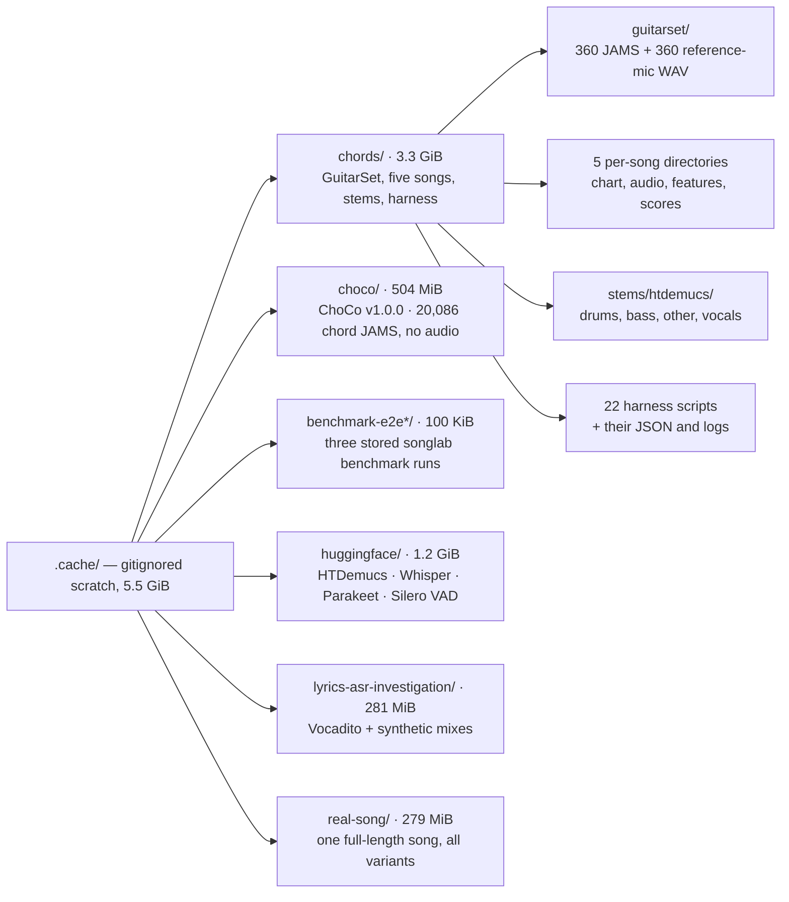
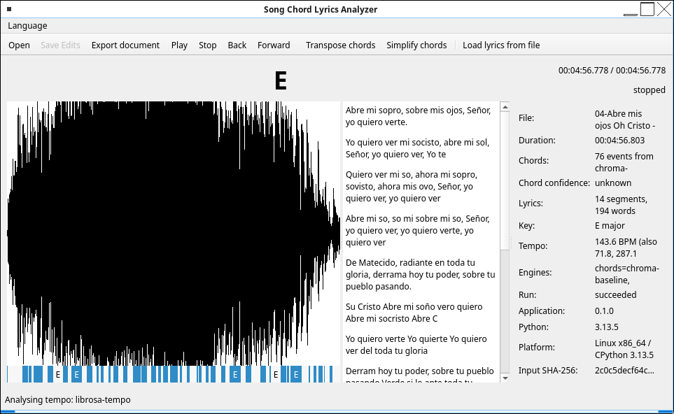

# song-chord-lyrics-analyzer

[](https://github.com/wachin/song-chord-lyrics-analyzer/actions/workflows/ci.yml)
[](LICENSE)
[](pyproject.toml)
[](#installation)
[](#design-principles)
[](#design-principles)
[](https://github.com/astral-sh/ruff)
[](#development)

A cross-platform, offline-first laboratory that analyzes an audio song and
produces a synchronized representation of its **lyrics, chords, beats, tempo
and key** — with confidence and provenance attached to every inference.

* **Package:** `song_chord_lyrics_analyzer`
* **CLI:** `songlab`
* **Platforms:** Linux, Windows, macOS
* **Licence:** GPL-3.0-or-later
* **Status:** the *first product milestone* is reached **in two front ends**. The
  whole path runs end to end: real audio file → shared decode service → chord
  analysis → timestamped `ChordEvent`s → playback → the chord under the playhead,
  drawn by `songlab play` as a terminal line (see the
  [demo](#demo-the-chords-follow-the-song)) and by `songlab gui` in a **desktop
  window** with a waveform timeline, a chord strip and a seekable playhead
  (roadmap Phase D, 2026-10-08). The repository, CLI, canonical typed model,
  engine interfaces, audio metadata, playback layer, tests and CI are all in
  place, and three engines are registered: chords `chroma-baseline` (CQT chroma
  matched against triad templates through an optional numpy/librosa front end),
  key `krumhansl` and tempo `librosa-tempo`. What is still missing is the
  *depth* of that window — editing, lyrics, exports, translations, the `[F]`
  work listed in [`docs/GUI_REQUIREMENTS.md`](docs/GUI_REQUIREMENTS.md). Accuracy
  work (Phase I) comes after that foundation; the measurements behind it (lyrics
  ASR, key, tempo) came from temporary, gitignored harnesses, and the chord
  measurement now has a committed one (`scripts/chord_benchmark.py`); all are
  recorded in
  [`docs/ENGINE_COMPARISON.md`](docs/ENGINE_COMPARISON.md) and
  [`docs/DEPENDENCY_MATRIX.md`](docs/DEPENDENCY_MATRIX.md).

## Why

Most tools hide a single model behind a single button. This project keeps the
analysis engine modular and inspectable, so a result is reported as:

```text
Chord: C
Confidence: 0.84
Time: 01:24.320–01:26.810

Evidence:
- Chordino: C
- Madmom: C
- Baseline: C/E
- Bass evidence: E
```

instead of pretending the algorithm is certain. Raw engine output is never
overwritten, and disagreement between engines is preserved rather than averaged
away.

## The problem we set out to solve: audio that already knows its chords

To know whether chord recognition is *right*, you need a reference: **song audio
paired with the name of the chord sounding at each moment** — audio segments
labelled with chords. Half of this project's research went into finding such a
resource, and the honest answer is that very few exist.

The search covered dozens of repositories, datasets and audio libraries. The
finding: **the resource we wanted already exists, and it is [GuitarSet](https://zenodo.org/records/3371780).**

| Source | Real song audio | Chord labels with timestamps | Licence | Verdict |
| --- | --- | --- | --- | --- |
| **GuitarSet** | yes — 360 real acoustic-guitar excerpts | yes — JAMS with chord (instructed *and* performed), beats, downbeats, tempo and key | **CC BY 4.0** | **adopted** — the one source with audio *and* timed chord boundaries under a permissive licence |
| Guitar-TECHS | yes — electric guitar, notes/scales/chords | chord/technique examples with per-string MIDI | CC BY 4.0 | candidate — note-level, not song progressions |
| isolated-guitar-chords | isolated single chords only | yes, one chord per clip | CC BY 4.0 | complementary — clean unit audio, not songs |
| EGFxSet | single notes through guitar effects | note-level | CC BY 4.0 | candidate — note-level |
| guitar-chord-mix | repack of the above | per-string note MIDI, not chord sequences | CC BY 4.0 / CC0 | redundant — its rows are already covered by GuitarSet |
| ChoCo | **no audio** | yes — 20,080 JAMS files | CC BY 4.0 (some partitions NC-SA) | annotations only — pair with audio you own |
| CASD | **no audio** | yes — 4 annotators per song | CC BY-NC-SA 4.0 | blocked — NC/SA, incompatible with GPL-3 |
| IDMT-SMT-Guitar / Chords / Chord-Sequences | synthetic or non-permissive | yes | CC BY-NC-ND 4.0 | blocked — NC/ND |
| chord-collection, frettler | **no audio** (fingering databases) | no | GPL / OLGA-derived | fingering reference only |

Two structural facts came out of this search, and both shaped the design:

1. **Audio rarely travels with the annotations.** Most timed chord references
   (ChoCo, CASD, Isophonics) ship labels only, because the recordings stay under
   their original copyright. GuitarSet is the exception.
2. **Permissive licences are the bottleneck.** The richest chord datasets
   (IDMT, CASD) are non-commercial or no-derivatives, so nothing from them may
   be committed into a GPL-3 repository.

GuitarSet's annotations were therefore pinned into **derived, annotation-only
fixtures** that tests and metrics run against, with the dataset licence and
provenance recorded inside the fixture itself:

* [`tests/fixtures/csr_oracle.json`](tests/fixtures/csr_oracle.json) — timed chord
  annotations for 22 comping takes plus the expected duration-weighted CSR.
* [`tests/fixtures/chord_metrics_oracle.json`](tests/fixtures/chord_metrics_oracle.json)
  — 143 pinned cases (alignment, evaluation and boundary metrics) cross-checked
  against NumPy and `mir_eval` reference implementations.

No audio is committed; only annotations and measured numbers. The full policy is
in [`docs/DATASET.md`](docs/DATASET.md).

### What else is in `.cache/` (the local scratch space)

`.cache/chords/guitarset/` is only the largest tenant of a **gitignored scratch
directory at the repository root**. Everything the research and measurement work
downloads or generates lives under `.cache/`, and none of it belongs to the
package:

* **It is not the runtime cache.** That one is `SONGLAB_CACHE_DIR` or the
  platform default that `songlab doctor` prints — `~/.cache/songlab` on Linux,
  `~/Library/Caches/songlab` on macOS, `%LOCALAPPDATA%\songlab\Cache` on Windows.
  No module in `src/` opens `.cache/`.
* **It is not in the history.** `.gitignore` line 58 ignores the whole directory,
  so a fresh clone simply starts without it.
* **It is not needed to run or test.** The tests read the committed annotation
  fixtures in [`tests/fixtures/`](tests/fixtures/), never the audio.

Measured in this checkout on 2026-10-18: **5.5 GiB**. The directory maps the
research that produced the numbers quoted in the docs:



Each tenant answers one question: `chords/` the chord accuracy, `choco/` the
annotation index and `--ref` loader checks, the `huggingface/` weights plus
`lyrics-asr-investigation/` and `real-song/` the lyrics comparison, and
`benchmark-e2e*/` the `songlab benchmark` command itself. The outcomes are what
[`docs/CHORD_DETECTION_AUDIT.md`](docs/CHORD_DETECTION_AUDIT.md),
[`docs/ENGINE_COMPARISON.md`](docs/ENGINE_COMPARISON.md) and
[`docs/DATASET.md`](docs/DATASET.md) record.

The same layout as a table: sizes are the `du` figures on 2026-10-18 in binary
units, so a file of a few kilobytes shows as the 4 KiB block it occupies.

| Path | Size | What it holds |
| --- | --- | --- |
| `chords/guitarset/` | 2.1 GiB | The measurement dataset: 360 takes (`.jams` + `_mic.wav`), 24 lead sheets and the two Zenodo zips. Detailed in the next subsection. |
| `chords/guitarset-features/` | 4.6 MiB | One `original.npz` per take, the cached feature matrix, so re-scoring does not decode the audio again. |
| `chords/guitarset-<take>/` | 61 MiB (24 dirs) | The 24-take sample run: a copy of one take's audio, its `features/original.npz`, `results/original.json` with the detected key and decoded chord segments, and `csr.json` with that take's per-view CSR rows. |
| `chords/<song>/` | 127 MiB (5 dirs) | One directory per user-supplied song — `abre-mis-ojos`, `a-quien-ire`, `gracia-sublime`, `levanto-mis-manos`, `palabras-de-vida-eterna`: `chart.json` (hand-written chord chart), `original.wav`, `features/*.npz`, `results/*.json` per stem condition, and the score files `csr.json` (agreement mode), `metrics.json`, `variants.json`, `transitions.json`, `robust.json` and `summary.json`. `gracia-sublime` also keeps its `lrclib.json` lyrics lookup. |
| `chords/stems/htdemucs/` | 985 MiB | Demucs four-stem separations (`drums`, `bass`, `other`, `vocals`) of those five songs — the material behind the "does separation help chords?" comparison. |
| `chords/*.py`, `*.json`, `*.log` | ~5 MiB | The historical throwaway harness: `chords.py` (the original decoder), `measure_decoders.py`, `measure_key.py`, `measure_tempo.py`, `guitarset_*.py`, `fit_*.py`, `sweep_v3.py`, `winner_sweep.py`, and `gen_key_oracle.py`, `gen_metrics_oracle.py`, `make_fixture.py` and `validate_oracle.py`, which generated the committed fixtures. Their JSON, JSONL and log outputs sit next to them. Since 2026-10-19 the reproducible chord harness is committed at `scripts/chord_benchmark.py`; these files are what it replaced. |
| `choco/` | 504 MiB | ChoCo v1.0.0 as downloaded (178 MiB zip) and extracted: `jams/` with 20,086 chord annotations, `meta.csv` and `LICENSE.md`. Annotation-only — no audio. It is the permissively licensed timed source the search settled on: its `meta.csv` showed it shares no song with the five charts, and its Harte-seconds JAMS are what `evaluation.guitarset.read_jams_chords` was validated on. |
| `benchmark-e2e/`, `benchmark-e2e-key/`, `benchmark-e2e-tempo/` | 100 KiB | Three stored `songlab benchmark` runs (chords on 2026-10-04, key and tempo on 2026-10-05): `cases/case.json` plus a symlink to the GuitarSet take being scored, and `reports/benchmark.{json,csv,md}`. `benchmark-e2e/make_case.py` regenerates the chord case from the JAMS. |
| `huggingface/` | 1.2 GiB | A Hugging Face download cache (`hub/` plus `xet/` logs) holding the four repositories the experiments pulled: HTDemucs (81 MiB of weights), faster-whisper-small (462 MiB), Parakeet TDT 0.6B ONNX (622 MiB encoder) and Silero VAD (2.3 MiB). No registered engine loads these, so the application never touches them. |
| `lyrics-asr-investigation/` | 281 MiB | The Whisper-versus-Parakeet comparison: `probe.py`, three driver scripts, `data/` (Vocadito excerpts and zip, six synthetic mix/stem conditions, Demucs output), `results/` (one JSONL plus metadata per engine and condition, and `summary.json`) and the run logs. |
| `real-song/` | 279 MiB | One full-length commercial song (272.04 s) taken end to end: `original.wav` and a 16 kHz copy, `stems/htdemucs/`, `results/` per engine, `diagnostics/`, the lyric reference and `summary.json`. |
| `lyrics/gen_lyrics_oracle.py` | 8 KiB | Generator for `tests/fixtures/lyrics_oracle.json`: deterministic perturbations of the committed references, scored by `jiwer`. |
| `chordify-initial-data.json` | 20 KiB | A saved Chordify page payload (Next.js `__NEXT_DATA__`) for one song, research evidence for "what does Chordify actually output?". Nothing reads it. |
| `cache.txt` | 1.2 MiB | A `tree` dump of this directory, 22,376 lines. A snapshot, not an input: delete and regenerate it when it goes stale. |
| `chords_venv_build.log` | 0 B | Empty leftover of the throwaway harness virtualenv build. |

To see the layout yourself:

```bash
du -sh .cache/* | sort -h     # what is large
find .cache -maxdepth 1 -mindepth 1 -type d -exec du -sh {} +
tree -a -L 2 .cache           # needs the `tree` package
```

All of it is reproducible from its source (the two Zenodo zips, the ChoCo
`v1.0.0` release, the Hugging Face repositories, or the harness scripts) except
the audio of the five songs and of `real-song/`: that is commercial material
supplied by the user, gitignored, never committed and never redistributed, and
this project cannot download it again. Deleting `.cache/` therefore loses those
local checks and the cached features, not anything the package needs. The next
subsection covers the GuitarSet part in detail.

### The GuitarSet copy on disk (`.cache/chords/guitarset/`)

When GuitarSet is used locally, it lives in the **gitignored cache at the
repository root**, not in the package and not in this repository's history:

```text
.cache/chords/guitarset/
```

The application never opens this path. It is the input of the *measurement* work
behind the recorded chord number — CSR 0.6029 on 180 comping takes against the
instructed lead sheet, recorded with its environment and date in
[`docs/ENGINE_COMPARISON.md`](docs/ENGINE_COMPARISON.md) §2 — and the harness that
scores it is committed at `scripts/chord_benchmark.py`, driven by the committed
manifest [`tests/fixtures/guitarset_comp_manifest.json`](tests/fixtures/guitarset_comp_manifest.json).
Only that manifest is in the repository; the audio never is.

#### Why your file manager cannot find it

Two ordinary reasons, neither of them a missing download:

* **The path starts with a dot.** `.cache` is a *hidden* directory, and file
  managers hide names beginning with `.` by default. In Thunar (the MX Linux
  default) press `Ctrl+H` or choose **View → Show Hidden Files**; Dolphin and
  Nautilus use the same shortcut. Nothing is missing — it is filtered out of the
  listing.
* **It sits in the repository, not in your home directory.** The path is relative
  to the clone, so it is *not* `~/.cache/...`. With a clone at
  `/home/user/Dev3/song-chord-lyrics-analyzer` (machine-specific example) the
  absolute path is
  `/home/user/Dev3/song-chord-lyrics-analyzer/.cache/chords/guitarset/`.
  Use `Ctrl+L` and paste the path, or from a terminal:

```bash
cd /path/to/song-chord-lyrics-analyzer/.cache/chords/guitarset
ls -lh | head          # the extracted files
```

#### What is inside

The directory is **flat — no subdirectories**. Counts and sizes below were
measured on 2026-10-18 in this checkout: **746 files, 2.1 GiB** (sizes in MiB, as
`du` reports them).

```text
.cache/chords/guitarset/
├── annotation.zip              37 MiB   original Zenodo annotation download (39.1 MB published)
├── audio_mono-mic.zip         627 MiB   original Zenodo audio download (656.9 MB published)
├── <take>.jams                360 files, 543 MiB   annotations, one per take
├── <take>_mic.wav             360 files, 923 MiB   audio, one per take
└── <take>.chart.txt            24 files, <100 KB  plain-text instructed lead sheets
```

| Entry | What it is |
| --- | --- |
| `annotation.zip` | The untouched `annotation.zip` from [Zenodo 10.5281/zenodo.3371780](https://zenodo.org/records/3371780): 39.1 MB / 37.3 MiB, the size the record publishes. MD5-verified against the record on 2026-09-29. Kept only as the original; the extracted `.jams` are what gets read. |
| `audio_mono-mic.zip` | The untouched `audio_mono-mic.zip` from the same record: 656.9 MB / 626.5 MiB, also as published. Same provenance and MD5 check. The extracted `.wav` files are what gets read, so the two zips (664 MiB together) are redundant once extraction has happened. |
| `<take>.jams` | JAMS annotation per take — JSON text, 0.24–6.1 MB (1.5 MB average). Each holds **17 annotations** (recounted 2026-10-18): two `chord` namespaces (index 0 = instructed lead sheet, index 1 = performed, semi-automatic transcription with manual verification), `key_mode`, `tempo`, `beat_position`, and six `pitch_contour` plus six `note_midi` (one per string). Excerpts run **14.40 s to 45.71 s** (median 29.69 s). |
| `<take>_mic.wav` | The reference-microphone mono mix the decoder analyses: **44.1 kHz, 16-bit PCM, one channel**, 1.2–3.8 MB each. GuitarSet also ships hexaphonic and pickup audio; those zips were not downloaded. |
| `<take>.chart.txt` | The instructed chord sheet in plain text for a 24-take subset (all `comp` takes), e.g. `[instructed lead sheet]` followed by one chord per line. Small enough to read in an editor. |

#### The take names

Every extracted file is named `<player>_<style><progression>-<bpm>-<key>_<comp|solo>`,
so `00_BN1-129-Eb_comp_mic.wav` is player `00`, style `BN` (bossa nova),
progression 1, 129 BPM, E♭ major, comping, reference-mic audio:

| Part | Meaning |
| --- | --- |
| `<player>` | `00`–`05`, the six GuitarSet players, 60 files each. |
| `<style>` | `BN` (bossa nova), `Funk`, `Jazz`, `Rock`, `SS` (singer-songwriter); 72 takes each. |
| `<progression>` | `1`–`3`, each appearing with two tempo/key variants, so every style has six pieces per player. |
| `<bpm>` | Tempo of that recording. |
| `<key>` | Sounding key, e.g. `Eb`, `C#`, `Bb`, `F#` — 13 key spellings in the set. |
| `comp` / `solo` | Comping (chordal accompaniment) or lead playing; **180 each**, both annotated. |

#### The rest of `.cache/chords/`

Next to `guitarset/` sit the scratch artefacts from the 2026-09-29 measurement
run. All of it is gitignored scratch state, and none of it is needed to run the
package:

* `guitarset_all.py`, `guitarset_aggregate.py`, `guitarset_ablation.py` — the
  decoding/aggregation scripts, with `guitarset_all*.jsonl`, `guitarset_*summary.json`
  and `guitarset_csr_views.log` holding their output.
* 24 `guitarset-<take>/` working directories from the sample run, each with
  `original.wav`, `features/`, `results/` and a `csr.json` holding that take's
  per-reference CSR rows.
* `guitarset-features/` — per-take feature dumps. The working directories and
  the feature dumps together take 66 MB.

The other tenants of `.cache/` — the five song directories, their stems, ChoCo,
the model downloads and the stored benchmark runs — are listed in the overview
above.

GuitarSet is **CC BY 4.0**: the audio may be kept and measured locally, but it is
never committed or redistributed here. Deleting `.cache/chords/guitarset/` only
means re-extracting the two Zenodo zips into the same path; the committed
annotation fixtures and the tests keep working without it.

## Design principles

1. **No GUI first.** The command-line laboratory was built and validated before
   any PyQt6 code existed; the window (Phase D) then arrived as one more client
   of the same session, so it holds no analysis of its own.
2. **Engines behind interfaces.** Any chord or lyrics engine is an adapter; the
   CLI and GUI never import it directly.
3. **A canonical typed model.** Not Markdown, not ChordPro — those are exporters.
4. **Uncertainty survives.** `unknown` is not `0.0`, unknown is not "no chord",
   and tempo ambiguity is reported rather than normalised.
5. **No unnecessary dependencies.** The core package has none.
6. **Cross-platform from day one.** `pathlib`, platform-aware path discovery, and
   no hard-coded `/tmp` or `C:\Users\...`.
7. **English first.** Translations come only after the English UI is frozen.
8. **Never invent numbers.** A benchmark, timing or accuracy figure is written
   down only if it was measured, and it states its environment and date.

## Where the project is going

The roadmap is a phase plan, and the analysis engine is built behind interfaces
before the CLI is allowed to grow. Current state and direction:

| Area | State |
| --- | --- |
| Repository, CLI, canonical typed model, engine protocols, audio metadata | **implemented** |
| Dependency and licence research (candidates adopted/deferred/rejected) | **done** |
| Chord metrics — timing-free (align, exact/root/quality/MIREX views) and boundary-aware (segment overlap, change detection, timing error) | **library code, dependency-free** |
| Lyrics / key / tempo / beat engines behind the interfaces | next |
| `songlab benchmark` — `benchmark/{benchmark.json,csv,md}` over stored results | implemented; `--engine` runs a registered chord engine over cases with audio |
| `songlab chords` — first analysis command, on a selectable registered engine | implemented |
| `songlab analyze` — chord + key + tempo engines assembled into the canonical document with provenance | implemented |
| `songlab play` — playback plus the chord under the playhead, refreshed as the song advances (`--at` for one position) | implemented |
| `chroma-baseline` engine — template matching with a Viterbi decoder (roadmap 19/20) | implemented |
| `krumhansl` key engine — chroma profile vs the Krumhansl-Kessler profiles (roadmap 31/32) | implemented |
| `librosa-tempo` tempo engine — BPM with half/double readings kept (roadmap 33) | implemented |
| Stem separation, alignment, fusion, exports | later |
| PyQt6 window — waveform timeline, chord strip, seekable playhead, chord label, analysis panel (`songlab gui`) | **implemented** (Phase D, minimal window; optional `gui` extra) |
| Editing, undo/redo, lyrics view, transpose, exports, translations in that window | not started (`[F]` work, see [`docs/GUI_REQUIREMENTS.md`](docs/GUI_REQUIREMENTS.md)) |

The metric definitions are already fixed in [`docs/BENCHMARK.md`](docs/BENCHMARK.md):
chord (exact/root/quality + segment overlap + timing error + change detection),
lyrics (WER/CER + word-timestamp error), key (exact + relative), tempo (absolute
and half/double BPM error, ambiguity reported not normalised). The order of work
lives in [`ROADMAP.md`](ROADMAP.md).

## Installation

Requires Python 3.10+ and `venv` + `pip`.

```bash
git clone https://github.com/wachin/song-chord-lyrics-analyzer
cd song-chord-lyrics-analyzer

python -m venv .venv
source .venv/bin/activate          # Windows: .venv\Scripts\Activate.ps1

python -m pip install --upgrade pip setuptools wheel
python -m pip install -e .         # add ".[dev]" for tests, linting, mypy

# to open the window, and to hear the song it plays:
python -m pip install -e ".[gui,dsp,playback]"
```

FFmpeg is optional but recommended: WAV files work out of the box, everything
else needs `ffmpeg` + `ffprobe` on your `PATH` (or in `SONGLAB_FFMPEG` /
`SONGLAB_FFPROBE`). See [`docs/TROUBLESHOOTING.md`](docs/TROUBLESHOOTING.md).

## First commands

```bash
songlab --help
songlab doctor                 # environment, FFmpeg status, caches, engines
songlab info song.mp3          # technical metadata
songlab info song.mp3 --json   # machine-readable
songlab info song.mp3 --hash   # add the SHA-256 used for caching/provenance
songlab chords song.wav        # chord detection with the first available engine
songlab chords song.wav --engine chroma-baseline --json   # select an engine, emit JSON
songlab analyze song.wav       # chords + key + tempo, assembled with provenance
songlab play song.wav          # play it and watch the chord under the playhead
songlab play song.wav --at 42  # just print the chord at 00:00:42
songlab gui song.wav           # open it in the desktop window (needs the gui extra)
```

Example:

```text
$ songlab info song.wav
File:        /music/song.wav
Format:      wav
Codec:       pcm_s16le
Duration:   00:03:45.320 (225.320 s)
Sample rate: 44100 Hz
Channels:    stereo
Bit depth:   16 bit
Bitrate:     1411 kbit/s
File size:   37.95 MiB
Probed with: ffprobe
```

`songlab play` needs the optional `dsp` extra (the chord engine) and, to make
sound, the `playback` extra plus an output device:

```bash
python -m pip install -e ".[dev,dsp,playback]"
```

Without an output device, `--at SECONDS` still answers *which chord is there*
(nothing is played), and a missing backend is reported as a dependency error
with an install hint rather than silence.

`songlab gui` needs the same two extras plus `gui` (PyQt6):

```bash
python -m pip install -e ".[gui,dsp,playback]"
songlab gui              # empty window; use Open... to pick a file
songlab gui song.wav     # or open one right away
```

Qt stays optional on purpose: `gui/` imports it lazily, so without the extra
every other command keeps working and `songlab gui` reports
`The desktop window needs PyQt6, which is not installed.` with the install
command, exiting with code 3 like any other missing optional dependency.

## Demo: the chords follow the song

One command turns a file into something you can watch. The line below is
refreshed in place while the song plays; with `--no-inline` (or when the output
is a pipe) every frame is printed on its own line, which is what the tests
assert. This transcript is captured from a generated four-second C-G-F-C
fixture — the same kind of file the tests build, not a real recording and not a
hand-written example; a real song simply prints its own file name, duration and
chord count:

```text
$ songlab play song.wav --frames 5 --interval 0.5 --no-inline
Playing
=======
File:     song.wav
Duration: 00:00:04.000
Chords:   4 events from chroma-baseline
00:00:00.000 / 00:00:04.000  [------------------------]  C    playing
00:00:00.505 / 00:00:04.000  [###---------------------]  C    playing
00:00:01.004 / 00:00:04.000  [######------------------]  C    playing
00:00:01.504 / 00:00:04.000  [#########---------------]  G    playing
00:00:02.005 / 00:00:04.000  [############------------]  G    playing
```

The chord, the position and the progress bar all come from the same
`SessionSnapshot` the synchronization tests drive on a fake clock, so the
display cannot show a chord the session does not claim for that instant. Chords
this engine gets wrong are still wrong — that is Phase I work; the demo claims
synchronization, not accuracy.

## The same slice, in a window

`songlab gui` opens the minimal desktop window (roadmap Phase D). It draws what
the terminal line prints, plus the surrounding timeline:

* the **waveform** of the decoded song, from peaks reduced to one column per
  pixel (`audio/peaks.py`) — drawn at true amplitude, so a quiet recording looks
  quiet;
* a **chord strip** under it, one band per detected event (`app/timeline.py`),
  with the label the session would report for that instant;
* a **playhead** over both, moved by the same frame the terminal display renders,
  so the window and the CLI can never disagree about what is sounding;
* a **transport** (open, play/pause, stop, back/forward) and a click-or-drag
  timeline that seeks, plus an **analysis panel** with the file, the duration,
  the key, the tempo, which engine ran for each layer, which layer was skipped,
  the run status and the provenance summary.

The synchronization is the same one the command line uses: one
`SongSession.snapshot()` per refresh, projected onto the same `DisplayFrame`. The
window is tested that way too — driven through a fake player and a frozen clock
offscreen, with one assertion that every frame it draws carries exactly the chord
`chord_at()` claims for its position, and one integration test that repeats it on
a generated song the real engine analysed and, where the machine has an output
device, during real playback.

What is still open in the window is the `[F]` list in
[`docs/GUI_REQUIREMENTS.md`](docs/GUI_REQUIREMENTS.md); today that is the
translations (the Language menu ships, but no catalogue does). Editing, undo and
redo, the lyrics view, transpose, simplify, the export dialog and the
confidence/engine rows have landed since the minimal window.

### Launching it by hand (MX Linux 25)

The commands below are the launch a user performed on **MX Linux 25** (Debian 13
based) with this repository's `.venv-chords` virtual environment (Python 3.13.5,
PyQt6 installed). They are run from a terminal, in the project directory; the
window needs the `gui`, `dsp` and `playback` extras already installed in that
environment.

```bash
cd /home/wachin/Dev3/song-chord-lyrics-analyzer
source .venv-chords/bin/activate
songlab gui
```



* `cd` changes to the repository directory. The absolute path above is an
  **example from one machine**; replace it with your own checkout's path if it
  differs.
* `source .venv-chords/bin/activate` activates the `.venv-chords` virtual
  environment, which is where `songlab` and its optional analysis/GUI libraries
  live. (A fresh install can use the `.venv` from the section above; activate
  whichever one holds the extras.)
* `songlab gui` starts the graphical application. The window opens with an
  empty timeline; use **Open...** to pick a song (or pass the file as an
  argument: `songlab gui song.wav`). The analysis runs before the waveform and
  chords appear, so a long song takes a moment.

In that manual session the user opened an MP3 file and, after processing,
reported seeing the waveform, a lyrics panel and the audio information on the
right, working playback with the position advancing along the waveform, and
chord names displayed and changing during playback. The user estimated that
about **75% of the chords were correct**, judged by listening and looking at
the display.

That figure is a **user-reported manual observation, not a benchmark or a
measured accuracy result**. It came from one song, with no reference
annotations and no repeatable procedure, so it must not be quoted as a
scientifically validated 75% chord-detection accuracy. An objective number
needs audio with timed reference chords and a fixed evaluation procedure; the
project's candidate is GuitarSet (CC BY 4.0), the metric definitions are in
[`docs/BENCHMARK.md`](docs/BENCHMARK.md), and the current engine's limits are
traced in [`docs/CHORD_DETECTION_AUDIT.md`](docs/CHORD_DETECTION_AUDIT.md).

When you have finished with the application, close the window and leave the
virtual environment in that terminal session with:

```bash
deactivate
```

`deactivate` is a shell command, run at the end of the session. It only ends
the virtual environment for that terminal; it does not delete the environment
and does not uninstall any package. Do not run it before launching the
application — a new terminal needs `source .venv-chords/bin/activate` again.

Planned commands, added phase by phase:

```text
songlab lyrics    song.mp3                    word-level lyric timestamps
songlab compare   song.mp3                    several engines side by side
songlab separate  song.mp3                    stem separation
songlab fuse      song.mp3                    consensus over engines
songlab export    song.mp3 --format chordpro  ChordPro, JSON, Markdown, ...
```

## What works today

| Capability | State |
| --- | --- |
| Canonical typed model (audio, lyrics, chords, beats, key, tempo, notes, stems, provenance) | implemented |
| Chord label parsing, rendering, transposition, uncertainty handling | implemented |
| Canonical JSON codec with schema version | implemented |
| Engine protocols + registry (`is_available`, `engine_info`) | implemented |
| Audio validation, FFmpeg discovery, metadata probing (WAV without FFmpeg) | implemented |
| `songlab info`, `songlab doctor`, error handling and exit codes | implemented |
| `songlab chords` — chord detection on a registry-selected engine (`--engine`, `--json`, time range) | implemented |
| Chord decoder — bulk majority smoothing or max-sum Viterbi with a measured change penalty and no-chord state | implemented |
| `krumhansl` key engine — key, mode and correlation confidence, scored by `songlab benchmark --engine` | implemented |
| `librosa-tempo` tempo engine — BPM scored as absolute, half-time and double-time error by `songlab benchmark --engine` | implemented |
| `songlab analyze` — the canonical document (`AnalysisResult` + `Provenance` + `AnalysisRun`) from the registered engines | implemented |
| `songlab play` — play a file and show the chord under the playhead, updating with playback (terminal display; `--at`, `--interval`, `--frames`) | implemented |
| `songlab gui` — the desktop window: waveform timeline, chord bands, playhead, transport, seek, analysis panel (optional `gui` extra) | implemented (minimal window, roadmap Phase D) |
| `SongSession` + presenters (`app/`) — open → decode → analyze → player → `chord_at()` → `SessionSnapshot` → frame, band and summary rows | implemented |
| Waveform peak data (`audio/peaks.py`) — min/max per drawn column, frame-aligned, dependency-free | implemented |
| Chord metrics (`metrics/`) — timing-free and boundary-aware scoring views | implemented as library code |
| Key, tempo and lyrics metrics (`metrics/`) — WER/CER, key relation, half/double BPM | implemented as library code |
| Chord scoring semantics (`evaluation/`) — MIREX equality, duration-weighted CSR | implemented as library code |
| `songlab benchmark` — scores stored reference/hypothesis cases into `benchmark/{json,csv,md}` | implemented; `--engine chroma-baseline` fills cases from a real measured run |
| GUI editing, undo/redo, lyrics view, transpose, exports, translations | not started (`[F]` work) |
| Further chord decoders, lyrics/beat engines, separation, alignment, fusion | not started |

## Development

```bash
pytest                # 1340 tests + environment-dependent skips, no network, no models
ruff check . && ruff format --check .
python -m mypy
```

Without PyQt6 the window's tests skip; the development environment installs it
with the other extras, `python -m pip install -e ".[dev,dsp,playback,gui]"`,
which is what the CI jobs do (`mypy` type-checks `gui/` against the real PyQt6
stubs, so the lint job installs `gui` too).

Finished roadmap work must be marked in the same change: the task moves to `[x]`
in [`ROADMAP.md`](ROADMAP.md) (`[~]` when only part of it landed); see
[`CONTRIBUTING.md`](CONTRIBUTING.md).

See [`docs/DEVELOPMENT.md`](docs/DEVELOPMENT.md) for setup conventions and how to
add an engine, [`docs/ARCHITECTURE.md`](docs/ARCHITECTURE.md) for the layering,
and [`docs/DEPENDENCY_MATRIX.md`](docs/DEPENDENCY_MATRIX.md) +
[`docs/LICENSE_AUDIT.md`](docs/LICENSE_AUDIT.md) for the research still pending
before any engine becomes a dependency.

## Research with AI coding agents

This repository is written to be worked on **together with an AI coding agent**,
and that is a deliberate part of the design. The ground rules an agent needs are
kept in [`AGENTS.md`](AGENTS.md), so anyone can point a fresh agent at the repo
and get correct, reproducible work — the faster developers join, the faster this
becomes something people rely on.

To start a parallel research effort with your own agent:

1. **Fork or clone** the repository and create the development environment above
   (`python -m pip install -e ".[dev]"`).
2. **Read the contract first.** Give your agent these files before it writes a
   line: [`AGENTS.md`](AGENTS.md) (agent rules), [`ROADMAP.md`](ROADMAP.md) (the
   specification and progress markers) and [`CONTRIBUTING.md`](CONTRIBUTING.md)
   (the human-facing rules).
3. **Pick a roadmap item** that is still `[ ]`, and treat its *Status* line as the
   definition of done.
4. **Keep the gate green** — the same four commands CI runs:
   `ruff check .`, `ruff format --check .`, `python -m mypy`, `pytest -q`.
5. **Record what you learned before you build.** New dependency or dataset
   findings go to [`docs/DEPENDENCY_MATRIX.md`](docs/DEPENDENCY_MATRIX.md) and
   [`docs/LICENSE_AUDIT.md`](docs/LICENSE_AUDIT.md); the roadmap marker is set in
   the same change.
6. **Measure, never invent.** Reproduce scratch experiments in a throw-away,
   gitignored harness, but commit the harness and a fixed manifest whenever the
   result is an accuracy claim that later work will be compared against
   (`scripts/chord_benchmark.py` + `tests/fixtures/guitarset_comp_manifest.json`
   are the pattern). Commit only annotation-only fixtures and the numbers they
   pin, each with its environment and date.

A good first instruction to hand your agent:

> Read `AGENTS.md`, `ROADMAP.md` and `CONTRIBUTING.md`. Pick the first unstarted
> roadmap item that matches this area, implement it with tests, run the full
> gate, and update the roadmap marker and the relevant docs in the same change.
> Do not import, install or copy anything from `external/`.

Two rules keep parallel work mergeable: **`external/` is read-only reference
material** (never a dependency — see [`AGENTS.md`](AGENTS.md)), and **generated
state stays out of the repository** (caches, `.venv*`, model downloads,
temporary WAVs).

## Documentation

| Document | Contents |
| --- | --- |
| [`ROADMAP.md`](ROADMAP.md) | the specification, phase plan and live progress tracker (`[x]` / `[~]` / `[ ]` markers) |
| [`docs/ARCHITECTURE.md`](docs/ARCHITECTURE.md) | layering, model, error codes, status |
| [`docs/DEVELOPMENT.md`](docs/DEVELOPMENT.md) | setup, conventions, adding an engine |
| [`AGENTS.md`](AGENTS.md) | rules for coding agents: `external/` is reference-only, roadmap markers |
| [`docs/DEPENDENCY_MATRIX.md`](docs/DEPENDENCY_MATRIX.md) | candidate dependencies and their verification status |
| [`docs/LICENSE_AUDIT.md`](docs/LICENSE_AUDIT.md) | code, model, dataset and tool licences |
| [`docs/DATASET.md`](docs/DATASET.md) | dataset policy, GuitarSet adoption, committed fixtures |
| [`docs/ENGINE_COMPARISON.md`](docs/ENGINE_COMPARISON.md) | measured engine comparisons and metric definitions |
| [`docs/BENCHMARK.md`](docs/BENCHMARK.md) | the metric specification and the planned `songlab benchmark` command |
| [`docs/TROUBLESHOOTING.md`](docs/TROUBLESHOOTING.md) | exit codes, FFmpeg, caches |
| [`docs/INTERNATIONALIZATION.md`](docs/INTERNATIONALIZATION.md) | English-first policy and Qt Linguist plan |
| [`docs/GUI_REQUIREMENTS.md`](docs/GUI_REQUIREMENTS.md) | the window that exists, and the `[F]` GUI work that does not |
| [`docs/CHORD_DETECTION_AUDIT.md`](docs/CHORD_DETECTION_AUDIT.md) | the chord path as it runs today, its test coverage, confirmed limits and the prioritized improvement plan (read-only audit) |

## Contributing

Contributions are welcome — see [`CONTRIBUTING.md`](CONTRIBUTING.md) for the
ground rules and [`AGENTS.md`](AGENTS.md) if you work with a coding agent. The
roadmap wins over convenience: research first, licence first, tests with every
change.

## Licence

GPL-3.0-or-later. Model weights, datasets and external tools have their own
licences; see [`docs/LICENSE_AUDIT.md`](docs/LICENSE_AUDIT.md) and
[`docs/DATASET.md`](docs/DATASET.md).
