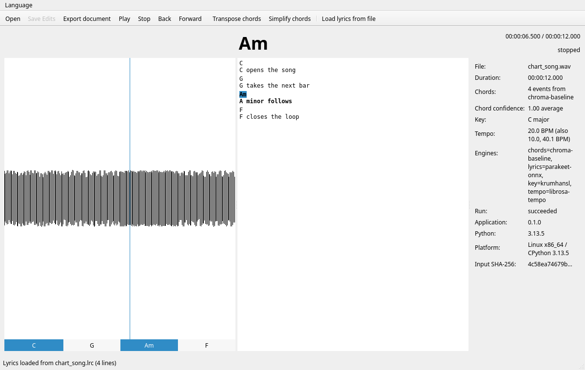

# Using SongLab: command line, playback and the desktop window

This is the detailed usage guide: the command-line commands, the `songlab play`
demo, the desktop window, and the MX Linux launch example. The README keeps only
the shortest path to the window; developers should also read
[`DEVELOPMENT.md`](DEVELOPMENT.md) and [`AGENT_ONBOARDING.md`](AGENT_ONBOARDING.md).

## First commands

```bash
songlab --help
songlab doctor                 # environment, FFmpeg status, caches, engines
songlab info song.mp3          # technical metadata
songlab info song.mp3 --json   # machine-readable
songlab info song.mp3 --hash   # add the SHA-256 used for caching/provenance
songlab chords song.wav        # chord detection with the first available engine
songlab chords song.wav --engine chroma-baseline --json   # select an engine, emit JSON
songlab analyze song.wav       # chords + key + tempo, assembled with provenance
songlab play song.wav          # play it and watch the chord under the playhead
songlab play song.wav --at 42  # just print the chord at 00:00:42
songlab gui song.wav           # open it in the desktop window (needs the gui extra)
```

Example:

```text
$ songlab info song.wav
File:        /music/song.wav
Format:      wav
Codec:       pcm_s16le
Duration:   00:03:45.320 (225.320 s)
Sample rate: 44100 Hz
Channels:    stereo
Bit depth:   16 bit
Bitrate:     1411 kbit/s
File size:   37.95 MiB
Probed with: ffprobe
```

`songlab play` needs the optional `dsp` extra (the chord engine) and, to make
sound, the `playback` extra plus an output device:

```bash
python -m pip install -e ".[dev,dsp,playback]"
```

Without an output device, `--at SECONDS` still answers *which chord is there*
(nothing is played), and a missing backend is reported as a dependency error
with an install hint rather than silence.

`songlab gui` needs the same two extras plus `gui` (PyQt6):

```bash
python -m pip install -e ".[gui,dsp,playback]"
songlab gui              # empty window; use Open... to pick a file
songlab gui song.wav     # or open one right away
```

Qt stays optional on purpose: `gui/` imports it lazily, so without the extra
every other command keeps working and `songlab gui` reports
`The desktop window needs PyQt6, which is not installed.` with the install
command, exiting with code 3 like any other missing optional dependency.

## Demo: the chords follow the song

One command turns a file into something you can watch. The line below is
refreshed in place while the song plays; with `--no-inline` (or when the output
is a pipe) every frame is printed on its own line, which is what the tests
assert. This transcript is captured from a generated four-second C-G-F-C
fixture — the same kind of file the tests build, not a real recording and not a
hand-written example; a real song simply prints its own file name, duration and
chord count:

```text
$ songlab play song.wav --frames 5 --interval 0.5 --no-inline
Playing
───────
File:     song.wav
Duration: 00:00:04.000
Chords:   4 events from chroma-baseline
00:00:00.000 / 00:00:04.000  [------------------------]  C    playing
00:00:00.505 / 00:00:04.000  [###---------------------]  C    playing
00:00:01.004 / 00:00:04.000  [######------------------]  C    playing
00:00:01.504 / 00:00:04.000  [#########---------------]  G    playing
00:00:02.005 / 00:00:04.000  [############------------]  G    playing
```

The chord, the position and the progress bar all come from the same
`SessionSnapshot` the synchronization tests drive on a fake clock, so the
display cannot show a chord the session does not claim for that instant. Chords
this engine gets wrong are still wrong — that is Phase I work; the demo claims
synchronization, not accuracy.

## The same slice, in a window

`songlab gui` opens the minimal desktop window (roadmap Phase D). It draws what
the terminal line prints, plus the surrounding timeline:

* the **waveform** of the decoded song, from peaks reduced to one column per
  pixel (`audio/peaks.py`) — drawn at true amplitude, so a quiet recording looks
  quiet;
* a **chord strip** under it, one band per detected event (`app/timeline.py`),
  with the label the session would report for that instant;
* a **playhead** over both, moved by the same frame the terminal display renders,
  so the window and the CLI can never disagree about what is sounding;
* a **chord chart over the lyrics**: every detected chord sits above the timed
  word it starts on, an instrumental intro/break gets its own chord row, and the
  active chord is highlighted while the line and word play (`app/chord_lyrics.py`
  + `gui/lyrics_view.py`);
* a **transport** (open, play/pause, stop, back/forward) and a click-or-drag
  timeline that seeks, plus an **analysis panel** with the file, the duration,
  the key, the tempo, which engine ran for each layer, which layer was skipped,
  the run status and the provenance summary.

Chord labels are respelled for the song's key on every surface: a song detected
in B flat shows `Bb`, `Eb` and `Gm` rather than `A#`, `D#` and `F#m`. The
canonical document keeps its sharp-spelled pitch classes, so exports, edits and
comparisons remain stable.

The synchronization is the same one the command line uses: one
`SongSession.snapshot()` per refresh, projected onto the same `DisplayFrame`. The
window is tested that way too — driven through a fake player and a frozen clock
offscreen, with one assertion that every frame it draws carries exactly the chord
`chord_at()` claims for its position, and one integration test that repeats it on
a generated song the real engine analysed and, where the machine has an output
device, during real playback.

What is still open in the window is the `[F]` list in
[`docs/GUI_REQUIREMENTS.md`](GUI_REQUIREMENTS.md); today that is the
translations (the Language menu ships, but no catalogue does). Editing, undo and
redo, the lyrics view, transpose, simplify, the export dialog and the
confidence/engine rows have landed since the minimal window.

### Launching it by hand (MX Linux 25)

The commands below are the launch a user performed on **MX Linux 25** (Debian 13
based) with this repository's `.venv-chords` virtual environment (Python 3.13.5,
PyQt6 installed). They are run from a terminal, in the project directory; the
window needs the `gui`, `dsp` and `playback` extras already installed in that
environment.

```bash
cd /home/wachin/Dev3/song-chord-lyrics-analyzer
source .venv-chords/bin/activate
songlab gui
```


The chart itself, captured offscreen on a generated C–G–Am–F fixture with a
matching `.lrc` (the active chord and lyric line are highlighted at
`00:00:06.500`):



* `cd` changes to the repository directory. The absolute path above is an
  **example from one machine**; replace it with your own checkout's path if it
  differs.
* `source .venv-chords/bin/activate` activates the `.venv-chords` virtual
  environment, which is where `songlab` and its optional analysis/GUI libraries
  live. (A fresh install can use the `.venv` from the README installation section;
  activate whichever one holds the extras.)
* `songlab gui` starts the graphical application. The window opens with an
  empty timeline; use **Open...** to pick a song (or pass the file as an
  argument: `songlab gui song.wav`). The analysis runs before the waveform and
  chords appear, so a long song takes a moment.

In that manual session the user opened an MP3 file and, after processing,
reported seeing the waveform, a lyrics panel and the audio information on the
right, working playback with the position advancing along the waveform, and
chord names displayed and changing during playback. The user estimated that
about **75% of the chords were correct**, judged by listening and looking at
the display.

That figure is a **user-reported manual observation, not a benchmark or a
measured accuracy result**. It came from one song, with no reference
annotations and no repeatable procedure, so it must not be quoted as a
scientifically validated 75% chord-detection accuracy. An objective number
needs audio with timed reference chords and a fixed evaluation procedure: the
project's is GuitarSet (CC BY 4.0), scored with `scripts/chord_benchmark.py`.
The currently recorded result is **CSR 0.6312** against the instructed lead
sheet (180 comping takes, 2026-10-27) and **0.6384** in the triad-reduced view;
the previous front end measured 0.6121 / 0.6183, and the first scoring step
(0.30 s minimum) measured 0.6283 / 0.6356. The gap to the numbers a
proprietary app quotes is real and structural: a 24-template chroma matcher is
not a large learned model, and those apps do not publish a comparable
evaluation. The measured limits and the next accuracy step are traced in
[`docs/CHORD_DETECTION_AUDIT.md`](CHORD_DETECTION_AUDIT.md) and
[`docs/ENGINE_COMPARISON.md`](ENGINE_COMPARISON.md) §8.

When you have finished with the application, close the window and leave the
virtual environment in that terminal session with:

```bash
deactivate
```

`deactivate` is a shell command, run at the end of the session. It only ends
the virtual environment for that terminal; it does not delete the environment
and does not uninstall any package. Do not run it before launching the
application — a new terminal needs `source .venv-chords/bin/activate` again.

Planned commands, added phase by phase:

```text
songlab lyrics    song.mp3                    word-level lyric timestamps
songlab compare   song.mp3                    several engines side by side
songlab separate  song.mp3                    stem separation
songlab fuse      song.mp3                    consensus over engines
songlab export    song.mp3 --format chordpro  ChordPro, JSON, Markdown, ...
```
